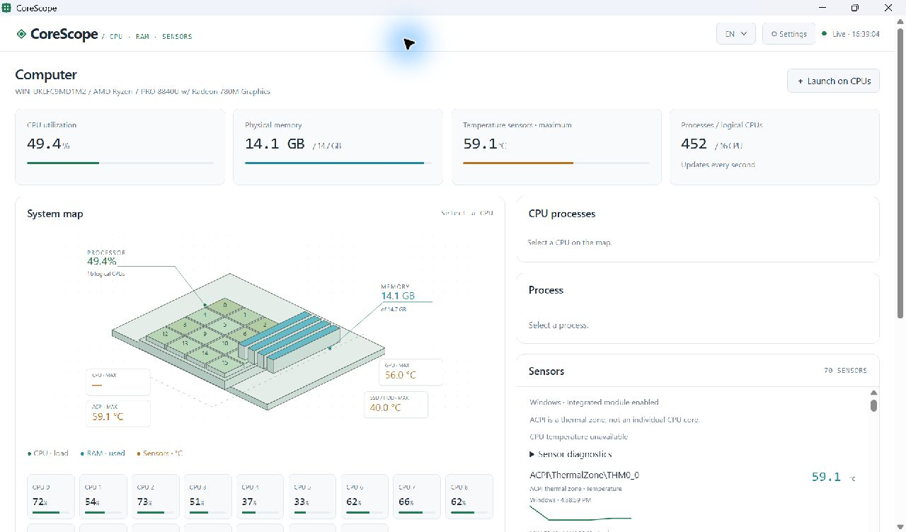
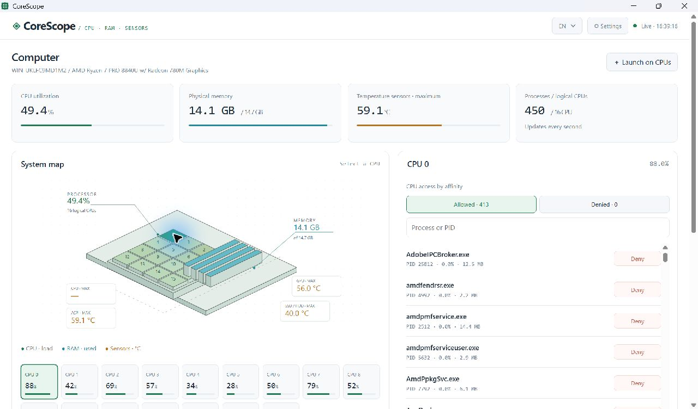

# CoreScope

A Windows desktop monitor for CPU affinity, process memory, and hardware telemetry. Built with Rust, with an isometric system map, a light interface, English/Russian localization, and a system tray menu.

[Download the installer](https://github.com/Sobolev5/corescope/releases/latest) · [All releases](https://github.com/Sobolev5/corescope/releases) · [Report an issue](https://github.com/Sobolev5/corescope/issues)

## Screenshots

### System overview

Live CPU utilization, RAM usage, and available temperature sensors. ACPI thermal zones are shown separately from CPU temperatures.



### Per-CPU process access

Select a logical CPU to view which processes may run on it. Allow or deny access directly from the process list.



Screenshots show a running application with real readings. Sensor availability varies by hardware, permissions, and drivers.

## Features

- **Interactive system map:** select a logical CPU and inspect its process access list.
- **CPU affinity controls:** allow or deny individual CPUs, or edit a process's complete affinity mask. The last allowed CPU cannot be removed.
- **Launch on selected CPUs:** start an executable with its affinity applied before its main thread resumes.
- **Process explorer:** search by name or PID, sort by CPU or RAM, and inspect the working set.
- **Virtual memory map:** committed regions, virtual addresses, sizes, allocation types, and protection flags.
- **Integrated hardware telemetry:** Windows ACPI/storage readings plus bundled LibreHardwareMonitorLib. No separate monitoring application is required.
- **Temperature history:** the latest 120 successful readings per sensor, with a graph and interval minimum/maximum.
- **Desktop integration:** tray menu, close-to-tray behavior, optional startup at sign-in, and persistent EN/RU settings.

## Install

Download `CoreScope-Setup-0.4.1.exe` from [Releases](https://github.com/Sobolev5/corescope/releases/latest). The English/Russian installer creates shortcuts and an uninstall entry. Startup at sign-in is optional and starts the application in the tray.

If Microsoft Edge WebView2 Runtime is missing, setup downloads it from Microsoft; an internet connection is needed for that step. The installer is currently unsigned.

**Requirements:** Windows 10/11 x64, Microsoft Edge WebView2 Runtime, and .NET Framework 4.7.2 or later for extended sensors.

For a portable installation, extract the entire ZIP and run `corescope.exe`. Keep `WebView2Loader.dll` and the `hardware` folder beside the executable.

## Use

1. Click a CPU tile on the map or a utilization card.
2. Use **Allowed** and **Denied** to inspect process access. **Deny** removes only the selected CPU; **Allow** restores it.
3. Click a process name to inspect its memory or edit its full CPU affinity mask. Select CPUs and click **Apply**.
4. Use **Launch on CPUs** to start an `.exe` on selected CPUs. Command-line arguments are not supported yet.

Closing the window keeps monitoring active in the tray by default. Click the tray icon or launch CoreScope again to restore the window. Choose **Exit** from the tray menu to quit. Close-to-tray can be disabled in **Settings**.

Switch between **EN** and **RU** in the toolbar or tray menu. Preferences are stored in `%LOCALAPPDATA%\CoreScope\settings.json`. Windows error messages and hardware-provided names retain their original language.

## Hardware sensors

Two independent collectors run in the background:

| Source | Readings |
| --- | --- |
| Windows ACPI / Storage | Firmware thermal zones and supported drive temperatures |
| Integrated LibreHardwareMonitorLib | Available CPU/GPU/motherboard temperatures, fans, power, voltage, clocks, and load |

Each reading includes its source and sample time. Disabling **Extended sensors** leaves the Windows collector active. CPU/process data refreshes about once a second; sensors refresh every five seconds plus collection time.

Some CPU sensors require PawnIO and elevated access. CoreScope does not install drivers or elevate itself automatically. Unsupported zero CPU-temperature readings are excluded; the interface reports that CPU temperature is unavailable. Sensor errors can be inspected under **Sensor diagnostics**.

History is held in memory until CoreScope exits. Missing samples are not replaced with invented readings.

## What the data means

- **Affinity is permission, not an execution trace.** The CPU process list shows where Windows may schedule a process. A multithreaded process can run on multiple CPUs and migrate between them. CoreScope does not collect ETW context-switch events.
- **CPU numbers identify logical processors.** They do not necessarily correspond to separate physical cores. The system map is schematic; the RAM bars show usage, not detected DIMM slots.
- **Memory addresses are virtual.** The memory view uses `VirtualQueryEx`; it does not expose physical RAM addresses, DIMM placement, memory contents, or CPU registers. Committed memory and the resident working set are different measurements.
- **ACPI is a firmware thermal zone.** It is not presented as a per-core temperature. The top temperature card shows the maximum of all currently available temperature sensors, not necessarily CPU Package.
- **Affinity changes are temporary.** They do not survive a process restart. Applications may change their own affinity, and launchers may delegate work to another process. Multi-processor-group affinity changes are not supported.
- **Protected processes may deny access.** Before process operations, CoreScope checks creation time to guard against PID reuse.

## Build and test

```powershell
cargo run --release
cargo test
cargo fmt --check
powershell -NoProfile -File scripts/build.ps1
powershell -NoProfile -File scripts/build-installer.ps1
```

Building the installer requires Inno Setup 6.1 or later. Set `ISCC` to the compiler path if it is not found automatically.

For API development, run `corescope.exe --no-open --port 8899`. The desktop application normally chooses a free local port.

```powershell
powershell -NoProfile -File scripts/smoke.ps1 -Base http://127.0.0.1:8899
powershell -NoProfile -File scripts/sensors-smoke.ps1 -Base http://127.0.0.1:8899
```

The API smoke test covers process identity, memory queries, affinity validation, launch behavior, and request guards. The sensor smoke test requires a machine exposing supported Windows and extended sensors; it checks real readings, history growth, and independent collector operation.

| File | Responsibility |
| --- | --- |
| `src/platform.rs` | Windows process handles, affinity, launch, and virtual memory |
| `src/main.rs` | Collectors, snapshots, and local API |
| `src/desktop.rs` | Native window, tray, DPI, and application lifecycle |
| `src/webview.rs` | Embedded WebView2 host |
| `assets/index.html`, `assets/i18n.js` | Interface and localization |
| `assets/sensors.ps1` | Windows and integrated-library sensor collection |

The server listens only on `127.0.0.1`, checks Host/Origin, and requires a random session token for changes. This protects against cross-origin requests, not other programs running as the same user. Do not expose it through a reverse proxy.

## Contributors

- [Sobolev5](https://github.com/Sobolev5)
- [itramb](https://github.com/itramb)

## License

CoreScope is licensed under [MIT](LICENSE). Bundled LibreHardwareMonitorLib is licensed under MPL-2.0; other dependencies retain their respective licenses. See [`assets/hardware/SOURCE.txt`](assets/hardware/SOURCE.txt), the accompanying license notices, and [`assets/webview2/LICENSE.txt`](assets/webview2/LICENSE.txt).
